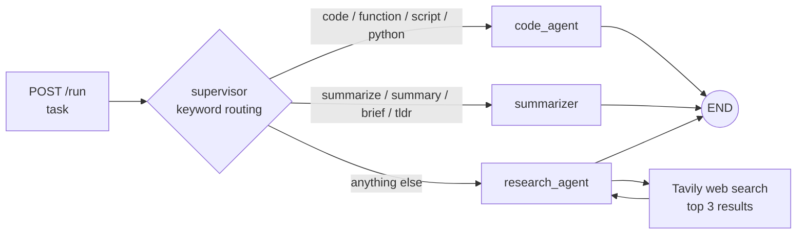

# AgentFlow

**A small LangGraph multi-agent prototype.** A supervisor node sends each task to one of three specialist agents (research, summarize, code), and a FastAPI app exposes the graph as a REST API.

> Status: learning prototype. Two Python files, no tests, not deployed.

## How it works



- **supervisor** — picks the agent with simple keyword rules (no LLM call).
- **research_agent** — runs a Tavily search, then asks Claude to answer from the results and cite sources.
- **summarizer** — asks Claude for a bullet-point summary.
- **code_agent** — asks Claude for Python code with docstrings and type hints.

All agents use Claude 3 Haiku through `langchain-anthropic`. State is a `TypedDict` (messages, task type, current agent, final output).

## Run it

Needs Python 3.11+, an Anthropic API key and a Tavily API key.

```bash
git clone https://github.com/prafulla2121/agentflow.git
cd agentflow
python -m venv venv
source venv/bin/activate        # Windows: venv\Scripts\activate
pip install -r requirements.txt

cp .env.example .env            # add ANTHROPIC_API_KEY and TAVILY_API_KEY
uvicorn main:app --reload --port 8000
```

Swagger UI: http://localhost:8000/docs

Or with Docker:

```bash
docker build -t agentflow .
docker run -p 8000:8000 --env-file .env agentflow
```

## API

| Method | Path | What it does |
| --- | --- | --- |
| `POST` | `/run` | Body `{"task": "..."}`. Returns `agent_used`, `task_type`, `output`, `status`. |
| `POST` | `/run/stream` | Same work, returned as one Server-Sent Event (the answer is not streamed token by token). |
| `GET` | `/agents` | Lists the agents. |
| `GET` | `/health` | Health check. |

```bash
curl -X POST http://localhost:8000/run \
  -H "Content-Type: application/json" \
  -d '{"task": "Write a Python function that checks if a string is a palindrome"}'
```

## Files

```
agents.py         LangGraph state, agent nodes and graph
main.py           FastAPI app
requirements.txt  pinned dependencies
Dockerfile        python:3.11-slim image running uvicorn
```

## Next steps

- LLM-based routing instead of keywords
- Real token streaming
- Let the research agent decide when to search (tool calling loop)
- Tests

## License

MIT — see [LICENSE](LICENSE).
